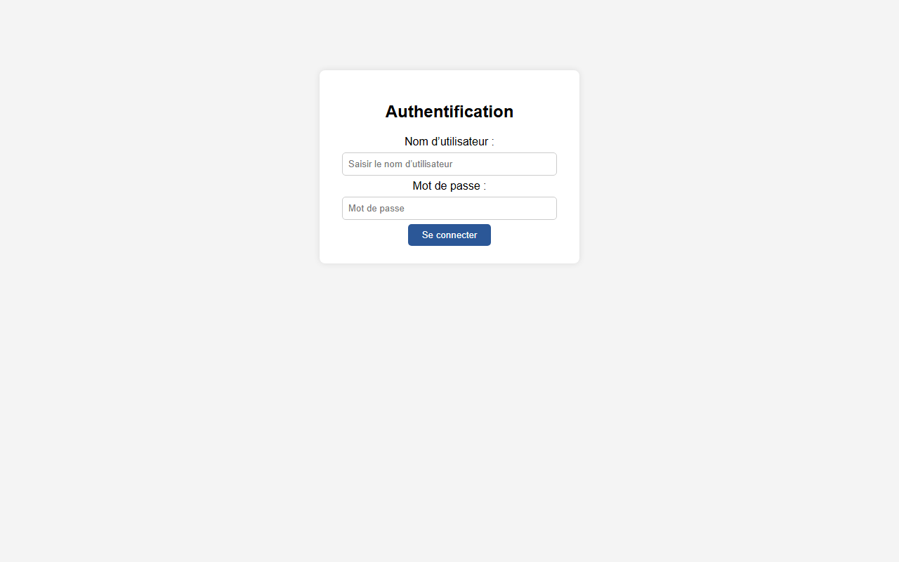
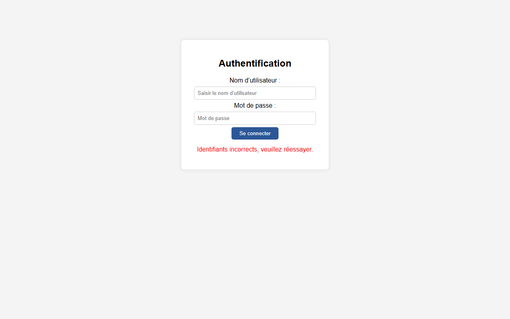
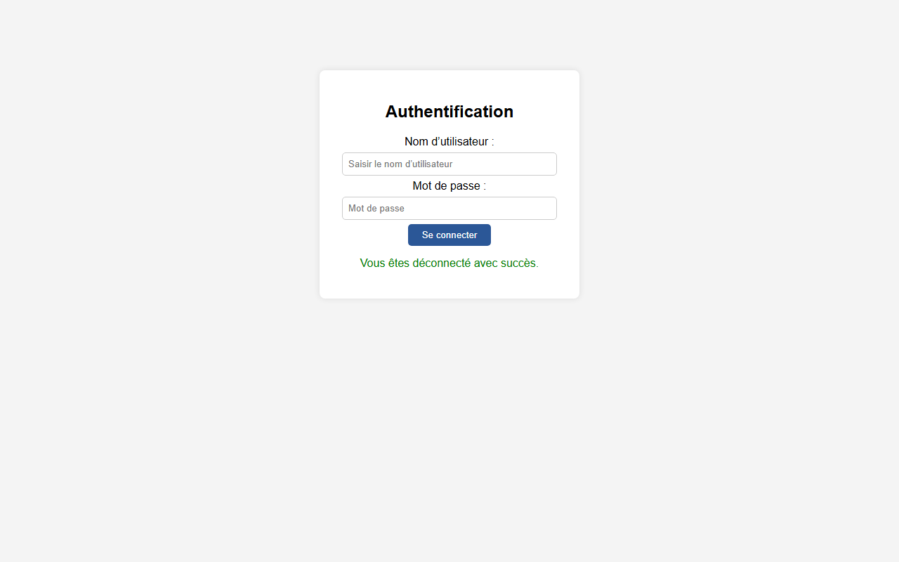
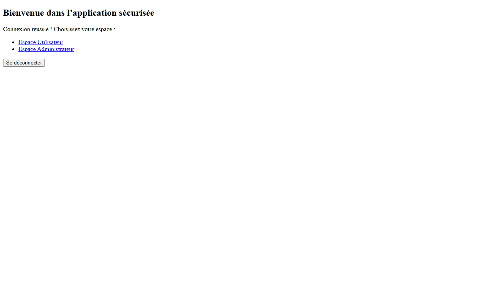
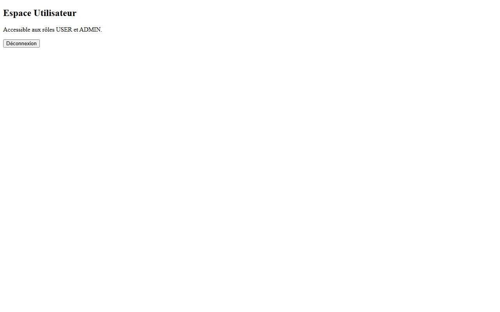
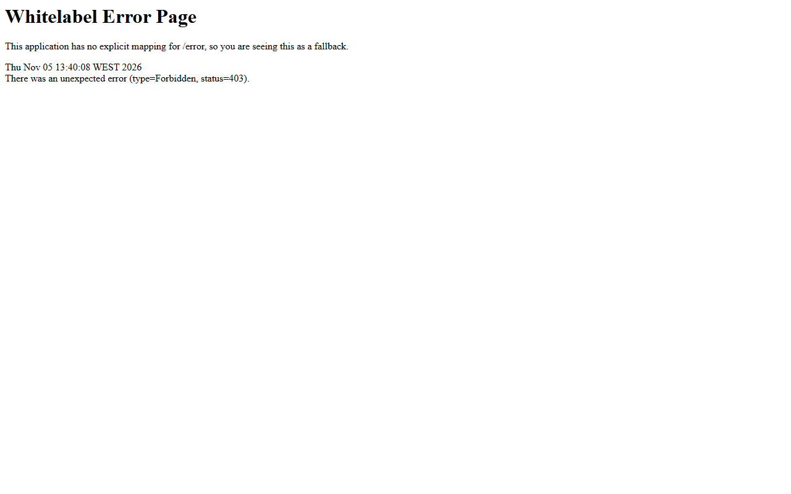
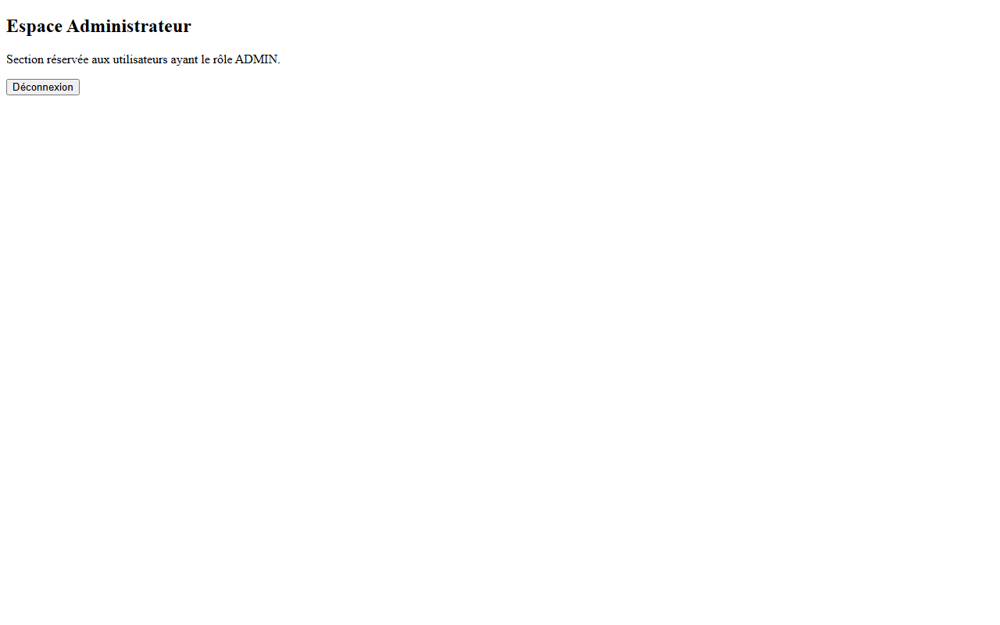

# Formulaire de connexion personnalisé — Spring Security

TP : personnalisation du mécanisme d'authentification de **Spring Security**.
On remplace la page de connexion par défaut par un formulaire HTML personnalisé, en gérant les erreurs de connexion, les redirections après authentification, la déconnexion et la restriction d'accès par rôle.

Application Spring Boot + Thymeleaf, utilisateurs stockés en mémoire.

---

## Aperçu

### 1. Page de connexion personnalisée


### 2. Erreur d'identifiants (`/login?error=true`)


### 3. Message de déconnexion (`/login?logout=true`)


### 4. Accueil après authentification (`/home`)


### 5. Espace utilisateur (`/user/dashboard`) — accessible à USER et ADMIN


### 6. Accès refusé — un USER sur `/admin/dashboard` reçoit une erreur **403**


### 7. Espace administrateur (`/admin/dashboard`) — réservé au rôle ADMIN


---

## Comptes de test

| Utilisateur | Mot de passe | Rôle  | Accès |
|-------------|--------------|-------|-------|
| `user`      | `1111`       | USER  | `/home`, `/user/**` |
| `admin`     | `1234`       | ADMIN | `/home`, `/user/**`, `/admin/**` |

---

## Structure du projet

```
src
 └─ main
     ├─ java/ma/fstg/security
     │   ├─ SecurityApplication.java        (classe de démarrage)
     │   ├─ config/SecurityConfig.java      (UserDetailsService + SecurityFilterChain)
     │   └─ web/AuthController.java         (mapping des vues)
     └─ resources
         ├─ application.properties
         └─ templates
             ├─ login.html                  (formulaire personnalisé)
             ├─ home.html
             ├─ admin-dashboard.html
             └─ user-dashboard.html
```

## Flux d'authentification

1. L'utilisateur demande une ressource protégée (`/user/dashboard`).
2. La `SecurityFilterChain` intercepte la requête ; l'utilisateur n'étant pas authentifié, il est redirigé vers `/login`.
3. Le formulaire envoie un `POST` vers `/authenticate` (URL traitée automatiquement par Spring Security, aucun contrôleur à écrire).
4. Spring compare les identifiants avec le `UserDetailsService`, crée un objet `Authentication` et le stocke dans le `SecurityContext`.
5. Succès → redirection vers `/home`. Échec → retour sur `/login?error=true`.

## Règles d'accès

| Route | Règle |
|-------|-------|
| `/login`, `/css/**` | public |
| `/admin/**` | rôle `ADMIN` |
| `/user/**` | rôles `USER` ou `ADMIN` |
| toute autre route | authentifié |

## Comportements vérifiés

| Action | Comportement observé |
|--------|----------------------|
| Accès sans authentification | redirection `302` vers `/login` |
| Connexion réussie | redirection `302` vers `/home` |
| Mauvais mot de passe | redirection `302` vers `/login?error=true` |
| Déconnexion | redirection `302` vers `/login?logout=true` |
| `/admin/dashboard` sans rôle ADMIN | erreur `403` — accès refusé |

---

## Lancer le projet

```bash
mvn spring-boot:run
```

Puis ouvrir : <http://localhost:8080/login>

## Notes techniques

- **Java 8 + Spring Boot 2.7.18** (Spring Security 5.7.11). Dans cette version, la surcharge `requestMatchers(String...)` n'existe pas encore : la configuration utilise donc `antMatchers("/login", "/css/**")` avec `authorizeHttpRequests(...)`, ce qui est la syntaxe équivalente pour Spring Security 5.7.
- La déconnexion se fait via un formulaire `POST /logout` : le logout est protégé par CSRF, un simple lien `GET` renverrait une erreur.
- Spring Security gère automatiquement la session, les cookies et la protection CSRF ; le jeton CSRF est injecté par Thymeleaf dans le formulaire.
